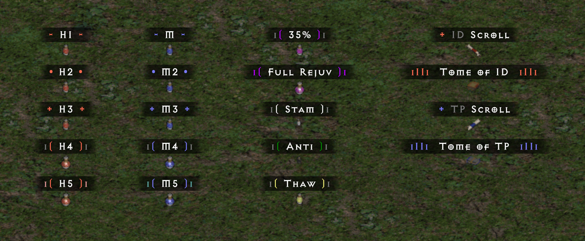
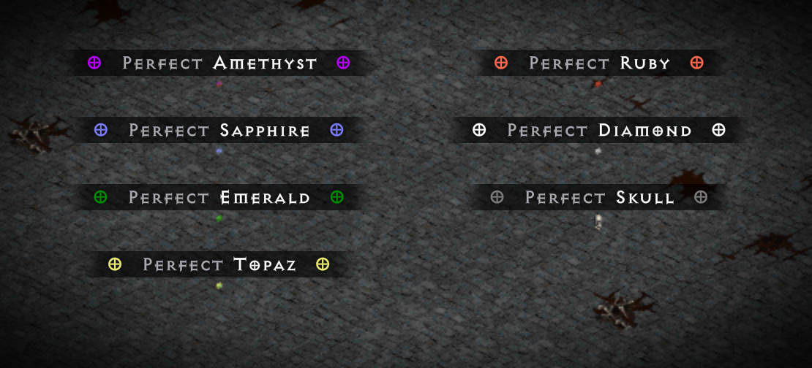
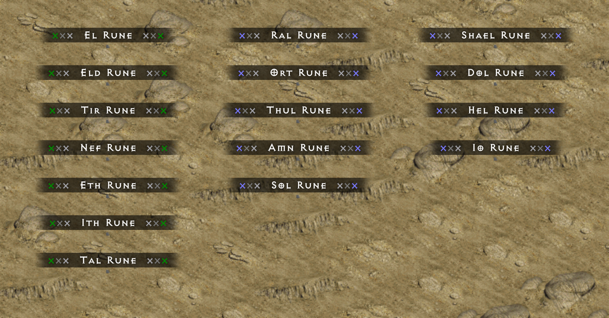
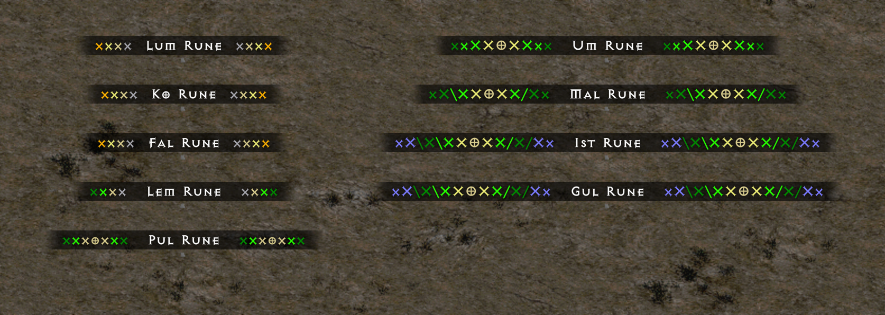
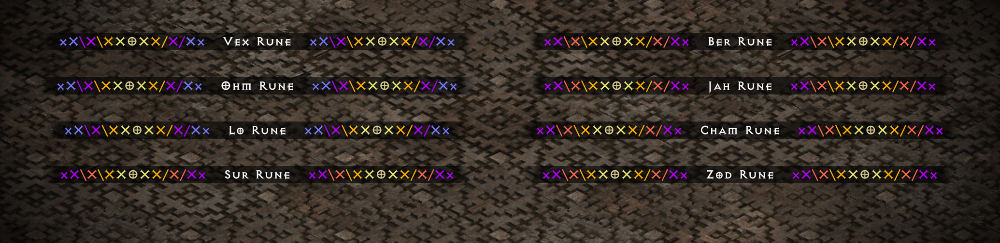
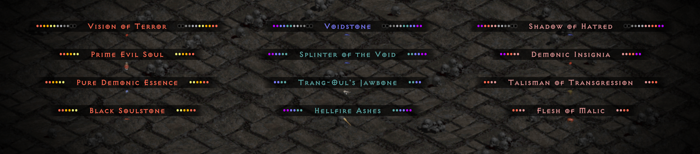

> [!TIP]
> ## **[Visit the Erazure Loot Filter website](https://filtersby-erazure.github.io/PD2-Loot-Filter/)**
> What each filter level shows and hides, the tiers of every unique and set item, non-magical bases, magic and rare items, skill and shop highlights, and more

# **Season 14 Alliance Update:**

My loot filters are updated for the Season 14 Alliance ladder reset on October 23rd, 2026

After selecting the version of the filter from the launcher, be sure to click "Save Filter" on the right side afterwards

## Versions of the Filter

- The **Erazure - Main** version displays standard names for all high runes and super rare items
- The **Erazure - BIG GG** version shows "BIG GG" or "LIL GG" when the following items drop while your character is outside of town:
  - BIG GG
    - Sur, Ber, Jah, Cham, Zod
    - Vial of Lightsong, Lilith's Mirror
    - Horadric Almanac
  - LIL GG 
    - Vex, Ohm, Lo
    - Larzuk's Puzzlebox
    - Horadric Navigator
    - Demonic Cube
    - Skeleton Key
- The PoE version of each filter adds sound notifications from PoE to certain items
- The Revealed version of each filter shows the identified names of unique and set items
- The **Minimal** version is the same as Erazure - Main but with a minimal style: fewer, simpler symbols around the names of items ([see the differences](https://filtersby-erazure.github.io/PD2-Loot-Filter/minimal/)). It also comes in Revealed, BIG GG and PoE versions, and every combination of them
- The **Corrlorized** versions (Corrlorized - Main - PoE, - Revealed - PoE, - BIG GG - PoE and - Revealed - BIG GG - PoE) are Corr's restyle of the four Erazure PoE versions: his own colors, symbols and PoE sound picks, with the same filter levels

# **Contact:**

- Message me on Discord if you have any questions, feedback, or suggestions: **erazure**

# **Examples of Stylization and Aesthetic:**

# **Filter Levels:**

What each filter level shows, notifies and hides, for every kind of item and at every character level, read from the filter's own rules: [Filter Levels](https://filtersby-erazure.github.io/PD2-Loot-Filter/filter-levels/) on the website.

# **Loot Filter Customization and Edits**

- I recommend using either [VS Code](https://code.visualstudio.com/download) or [Notepad++](https://notepad-plus-plus.org/downloads/) for editing a customized version of the filter

## VS Code

- Download [VS Code](https://code.visualstudio.com/download) from Visual Studio Code's website
  
- Under File - Preferences - Extensions - Search for "TommyC90"

- Install the Diablo 2 Loot Filter Hints Extension

- This adds helpful color coding to the syntax of .filter files

- Then navigate to the file of the filter version you would like to edit. Click on the three dots on the top right of the screen then click Download
    

- Under File - Open File - Navigate to where the file was downloaded and open it

- You are then free to make the edits you want

- After this, save the file to Diablo II\ProjectD2\filters\local. Be sure that it is saved as a .filter file

- In the launcher under Item Filter Properties, click Local Filter, select the file, then click Save Filter
    

## Notepad++

- Download the latest version of [Notepad++](https://notepad-plus-plus.org/downloads/)

- Open up the program after installing it

- Then navigate to the file of the filter version you would like to edit. Click on the three dots on the top right of the screen then click Download

- You are then free to make the edits you want

- After this, save the file to Diablo II\ProjectD2\filters\local. Be sure that it is saved as a .filter file

- In the launcher under Item Filter Properties, click Local Filter, select the file, then click Save Filter
    

