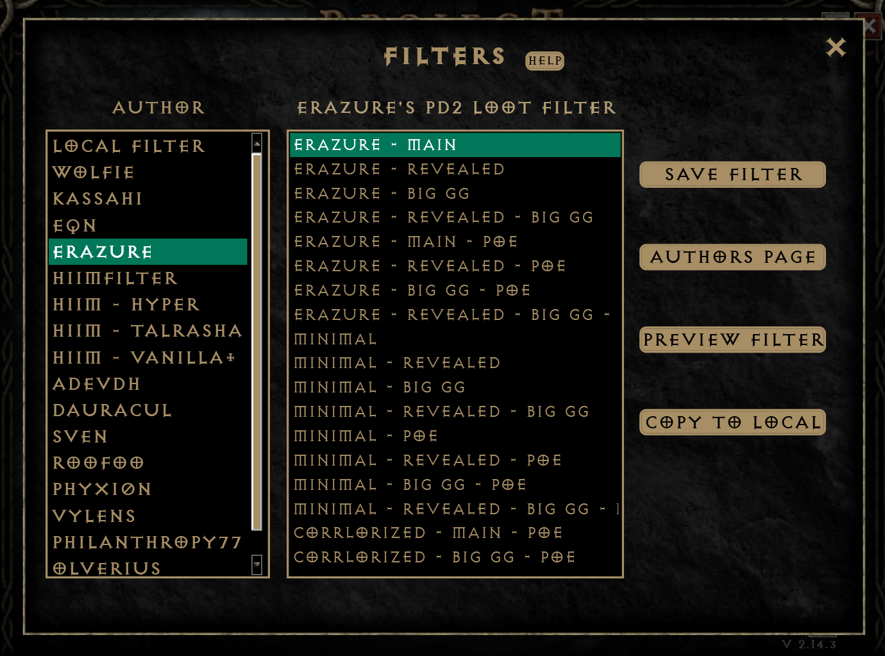

# Versions of the Filter

Pick a version in the launcher, then click **Save Filter** on the right side.

- The **Erazure - Main** version displays standard names for all high runes and super rare items
- The **Erazure - BIG GG** version shows "BIG GG" or "LIL GG" when the following items drop while your character is
  outside of town:
    - BIG GG
        - Sur, Ber, Jah, Cham, Zod
        - Vial of Lightsong, Lilith's Mirror
        - Horadric Almanac
    - LIL GG
        - Vex, Ohm, Lo
        - Larzuk's Puzzlebox
        - Horadric Navigator
        - Demonic Cube
        - Skeleton Key
- The **PoE** version of each filter adds sound notifications from PoE to certain items
- The **Revealed** version of each filter shows the identified names of unique and set items
- The **Minimal** version is the same as Erazure - Main but with a minimal style: fewer, simpler symbols
  around the names of items ([see the differences](minimal.md)). It also comes in Revealed, BIG GG and PoE
  versions, and every combination of them
- The **Corrlorized** versions (Corrlorized - Main - PoE, - Revealed - PoE, - BIG GG - PoE and - Revealed -
  BIG GG - PoE) are Corr's restyle of the four Erazure PoE versions: his own colors, symbols and PoE sound picks,
  with the same filter levels

{ width="994" }

## In the launcher

| Version | Description |
|---|---|
| Erazure - Main | Highly stylized loot filter with multiple filter level tiers for customizable strictness, colorful and intuitive symbols for runes, gems, maps, charms, etc. |
| Erazure - Revealed | Same as Erazure - Main but unidentified unique and set items show as their identified names when dropped. |
| Erazure - BIG GG - Mystery | Same as Erazure - Main but with a twist: high runes and super rare drops hide their identity on the ground when dropped, showing as BIG GG until you pick them up. |
| Erazure - Revealed - BIG GG | Same as Erazure - BIG GG but unidentified unique and set items show as their identified names when dropped. |
| Erazure - Main - PoE | Same as Erazure - Main but with Path of Exile sound effects on valuable drops. Polished visuals and tiered, customizable filter levels enhanced with PoE-style sound notifications. |
| Erazure - Revealed - PoE | Same as Erazure - Main - PoE but unidentified unique and set items show as their identified names when dropped. |
| Erazure - BIG GG - PoE | The mystery of BIG GG drops combined with Path of Exile sound notifications. |
| Erazure - Revealed - BIG GG - PoE | Same as Erazure - BIG GG - PoE, but unidentified unique and set items show as their identified names when dropped. |
| Minimal | Minimalist version of Erazure - Main with the same filter level tiers for customizable strictness, but simpler, cleaner symbols around item names for a more understated look. |
| Minimal - Revealed | Same as Minimal but unidentified unique and set items show as their identified names when dropped. |
| Minimal - BIG GG - Mystery | Same as Minimal but with a twist: high runes and super rare drops hide their identity on the ground when dropped, showing as BIG GG until you pick them up. |
| Minimal - Revealed - BIG GG | Same as Minimal - BIG GG but unidentified unique and set items show as their identified names when dropped. |
| Minimal - PoE | Same as Minimal but with Path of Exile sound effects on valuable drops. |
| Minimal - Revealed - PoE | Same as Minimal - PoE but unidentified unique and set items show as their identified names when dropped. |
| Minimal - BIG GG - PoE | Same as Minimal - BIG GG but with Path of Exile sound effects on valuable drops. |
| Minimal - Revealed - BIG GG - PoE | Same as Minimal - BIG GG - PoE but unidentified unique and set items show as their identified names when dropped. |
| Corrlorized - Main - PoE | Corr's restyle of Erazure - Main - PoE: the same filter level tiers for customizable strictness, with his own colors, symbols and Path of Exile sound picks. |
| Corrlorized - Revealed - PoE | Same as Corrlorized - Main - PoE but unidentified unique and set items show as their identified names when dropped. |
| Corrlorized - BIG GG - PoE | Same as Corrlorized - Main - PoE but with a twist: high runes and super rare drops hide their identity on the ground when dropped, showing as BIG GG until you pick them up. |
| Corrlorized - Revealed - BIG GG - PoE | Same as Corrlorized - BIG GG - PoE but unidentified unique and set items show as their identified names when dropped. |